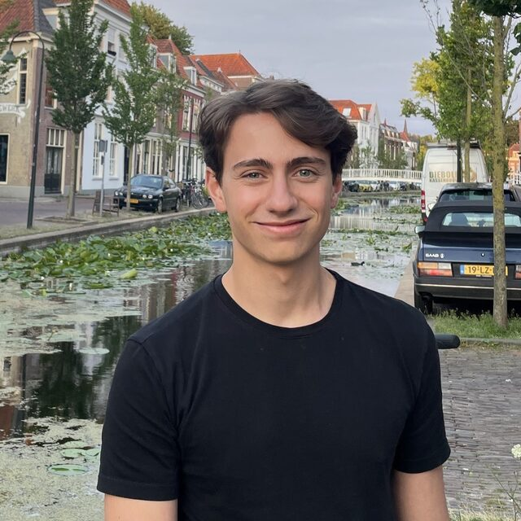

# Jorge Romeu Huidobro

I am a Research Engineer at [ALLSIDES](https://www.allsides.tech/) working on 3D reconstruction and inverse rendering for e-commerce and synthetic-data generation applications.

Previously I studied computer science at [TU Delft](https://www.tudelft.nl/). For my master's thesis I worked on conditioning generative models on 3D geometry with [Prof. Petr Kellnhofer](https://kellnhofer.xyz/). Before that, I worked on physically based rendering with [Prof. Elmar Eisemann](https://graphics.tudelft.nl/), haptic teleoperation with [Prof. VP](https://www.tudelft.nl/en/staff/r.r.venkateshaprasad/), and static analysis tooling with [Prof. Andy Zaidman](https://azaidman.github.io/).

In my free time I enjoy hiking, skiing, history, and learning something new.

[Email](mailto:jorge.romeu.huidobro@gmail.com) · [GitHub](https://github.com/jorgeromeu) · [LinkedIn](https://www.linkedin.com/in/jorge-romeu-huidobro-748458164/)

