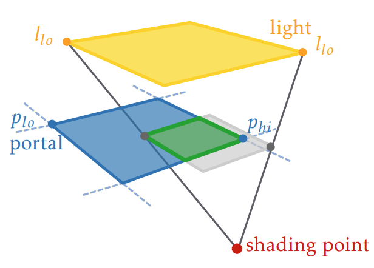
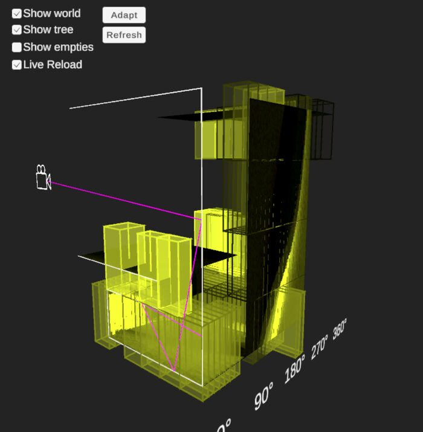
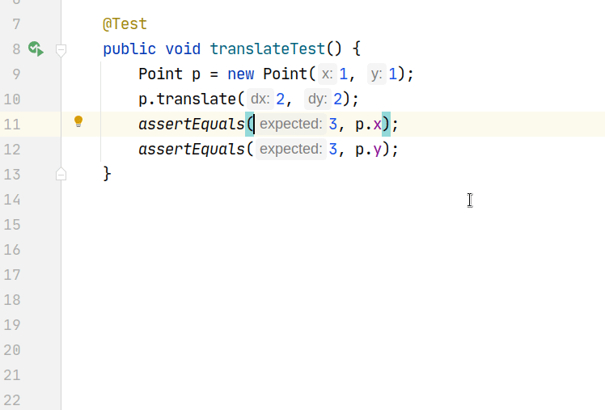

# Projects

<!--
  Each "### Title" block is one box. Boxes show in the order they appear here:
  move a block up or down to reorder.

  Title:
  - ### Title                                plain, not clickable
  - ### [Title](projects/my-project/index.md) whole box opens an in-site page (make a folder
                                              projects/my-project/ with an index.md, like the others)
  - ### [Title](https://…)                   title links out

  Each project keeps its media in its own folder, projects/my-project/.
  Inside a block, in any order:
  -    thumbnail, shown square. .mp4 plays on hover; the same-name
                            .jpg is what shows when not hovered. .jpg/.png/.svg are shown as-is.
  - `M.Sc. Thesis` `2025`   tags in backticks, only when meaningful (thesis, venue). A year is plain text.
  - **Me**, Co-author       authors line (comma-separated, your name in **bold**).
  - Description             a normal paragraph. Keep it ~3 lines: the box is as tall as the thumbnail.
  - [Paper](…) · [Code](…)  links row. Icons come from the label: Paper/Thesis/PDF, Code, Blog post,
                            Video, Slides; anything else gets a link icon.
-->

### Geometry-Guided Video Generation with Diffusion Feature Textures

`M.Sc. Thesis` `2025`

**Jorge Romeu Huidobro**, [Petr Kellnhofer](https://kellnhofer.xyz), [Lukas Uzolas](https://lukas.uzolas.com/), [Ricardo Marroquim](https://graphics.tudelft.nl/~marroquim/), [Elmar Eisemann](https://graphics.tudelft.nl/~eisemann/)

Video generation from an animated 3D mesh with a 2D diffusion model, using diffusion features extracted while texturing the mesh to keep frames temporally consistent.

[Thesis](https://repository.tudelft.nl/record/uuid:2f42fdf6-d988-4096-957a-ab8d1d3bf5f2) · [Code](https://github.com/Jorgeromeu/diffusion-feature-textures)

### Efficient Area Light Sampling with Light Portals

`B.Sc. Thesis` `2022`

**Jorge Romeu Huidobro**, [Mark van de Ruit](https://markvanderuit.nl/), [Elmar Eisemann](https://graphics.tudelft.nl/~eisemann/)

Sampling partially occluded lights with artist-specified portals: a light's visibility through a portal is exactly the shadow the portal casts, so shadow volumes pick the best strategy per shading point.

[Thesis](https://repository.tudelft.nl/file/File_cba11b10-ea54-4806-b4e8-ec215b5a8c73?preview=1) · [Code](https://github.com/Jorgeromeu/bsc-thesis)

### [Scaling Down NeRF with NeRF2D](projects/nerf2d/index.md)

**Jorge Romeu Huidobro**, Chrysanthos Kindinis, Roy Katz

A 2D analogue of NeRF that reconstructs 2D shapes from 1D renders, letting us replicate results from NeRF follow-ups with an order of magnitude less compute.

[Blog post](https://hackmd.io/@WdAcp83GSrSWsVvpRJWJ2w/SkPKXfsS0) · [Code](https://github.com/Jorgeromeu/NeRF2D)

### Blender Geometry Processing Add-on

**Jorge Romeu Huidobro**, [Pavlos Makridis](https://pavlosmak.github.io/), Rodrigo Álvarez Lucendo

A Blender plugin with Iterative Closest Point variants for mesh registration and Laplacian / gradient-based mesh editing tools.

[Code](https://github.com/Jorgeromeu/blender-geometry-processing)

### Visualizing Practical Path Guiding

**Jorge Romeu Huidobro**, [Pavlos Makridis](https://pavlosmak.github.io/)

A 2D path tracer and interactive tool to watch Practical Path Guiding's spatio-directional tree learn the light field, which becomes easy to visualize in 2D.

[Code](https://github.com/PavlosMak/Visualizing-Practical-Path-Guiding)

### The Unnamed Game Engine

**Jorge Romeu Huidobro**, [Pavlos Makridis](https://pavlosmak.github.io/)

An OpenGL game engine built from scratch, with an entity component system, shadow mapping, PBR shaders, SDF glyph rendering and Bézier curve animation.

[Code](https://github.com/PavlosMak/UnnamedGameEngine)

### [TestKnight: An Interactive Assistant for Test Engineering](https://ieeexplore.ieee.org/document/9793793)

`ICSE 2022`

C. Botocan\*, P. Deshmukh\*, [P. Makridis](https://pavlosmak.github.io/)\*, **J. Romeu Huidobro**\*, M. Sundarrajan\*, [M. Aniche](https://mauricioaniche.com/), [A. Zaidman](https://azaidman.github.io/)

An IntelliJ plugin for writing Java unit tests, with automatic assertion suggestions, MC/DC flow analysis and enhanced code coverage.

[Paper](https://ieeexplore.ieee.org/document/9793793) · [Code](https://github.com/SERG-Delft/testknight)
