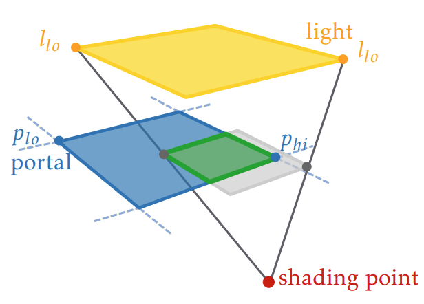

# Efficient Area Light Sampling with Light Portals

`B.Sc. Thesis` `2022`

**Jorge Romeu Huidobro**, [Mark van de Ruit](https://markvanderuit.nl/), [Elmar Eisemann](https://graphics.tudelft.nl/~eisemann/)

[Thesis](https://repository.tudelft.nl/file/File_cba11b10-ea54-4806-b4e8-ec215b5a8c73?preview=1) · [Code](https://github.com/Jorgeromeu/bsc-thesis)

In physically based rendering, sampling light sources is challenging when they are partially occluded (e.g. a bulb inside a lampshade). We propose using artist-specified portals which indicate openings to a light. Our key insight is that the regions of visibility of a light through a portal correspond exactly to the regions of the imaginary shadow cast by the portal. We can then re-use existing shadow volume algorithms to determine the optimal sampling strategy for the portal depending on the location of the shading point.
