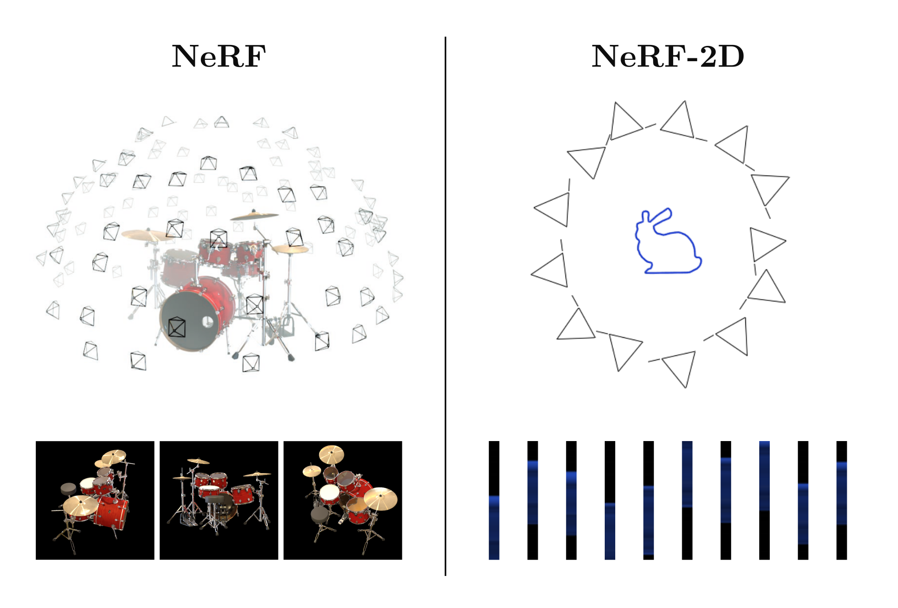
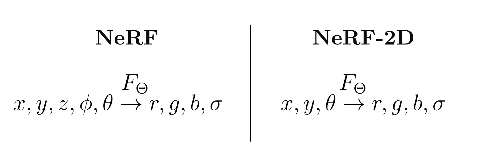
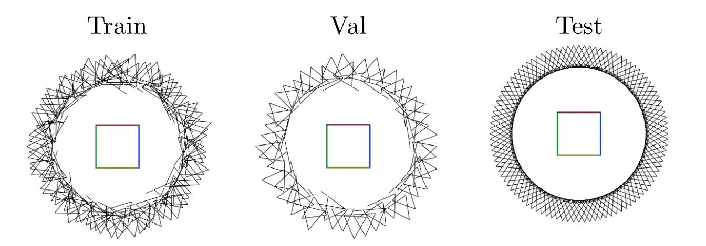
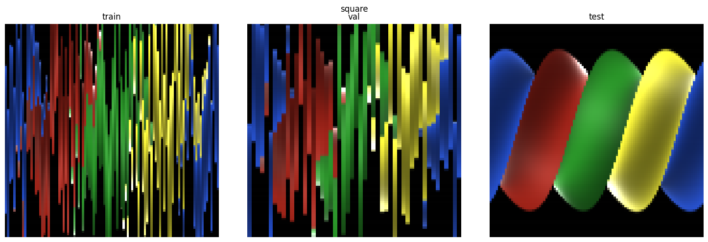
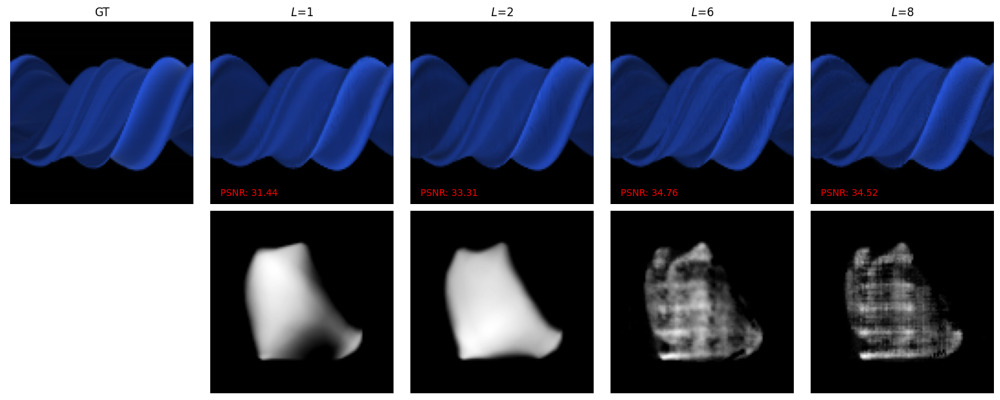
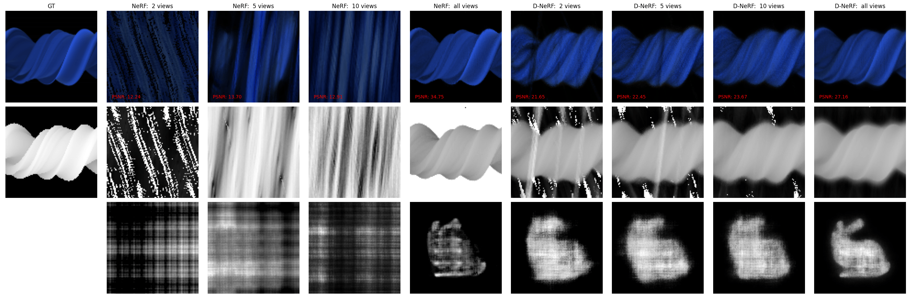
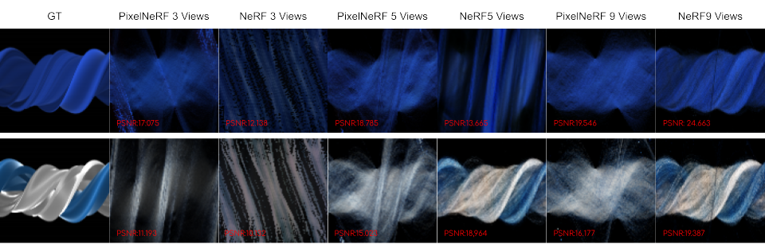

# Scaling Down NeRF with NeRF2D

**Jorge Romeu Huidobro**, Chrysanthos Kindinis, Roy Katz

[Blog post](https://hackmd.io/@WdAcp83GSrSWsVvpRJWJ2w/SkPKXfsS0) · [Code](https://github.com/Jorgeromeu/NeRF2D)

[NeRFs](https://hackmd.io/@WdAcp83GSrSWsVvpRJWJ2w/SkPKXfsS0#fn1) learn to represent a 3D scene from posed 2D images using differentiable volume rendering, but training and rendering NeRFs is costly, making small-scale experimentation difficult. **We propose a 2D analogue of this same task: reconstructing _2D shapes_ from _1D renders_**. This simplified setting lets us replicate results from various NeRF follow-ups using an order of magnitude less compute.

## NeRF in 2D

NeRF represents a 3D scene as a MLP $F_\Theta$ that maps a position $(x,y,z)$ and direction $(\phi,\theta)$ to a color $c=(r,g,b)$ and density $\sigma$ where the weights $\Theta$ are the parameterization of the scene:

$$
F_\Theta : (x, y, z, \theta, \phi) \to (r, g, b, c)
$$

The parameters are then fittted by rendering the 3D volume to a 2D image, computing a photometric loss and backpropagating the renderer to update the parameters. The analogous 2D task can be obtained by simply droppping the $z$ dimension:

Instead of 2D images taken from 3D camera poses, the training data are 1D images taken from cameras with a 2D position and a single viewing angle. The network maps a 2D point $(x, y)$ and an angle $θ$ to color and density, and everything else (ray marching, volume rendering, the photometric loss) stays exactly the same. 

## Experiments

We implement a synthetic-data generation pipeline in blender and render 2D novel view synthesis datasts for various objects. For each object we generate sparse training/validation cameras and uniformly placed tesing cameras from held-off viewpoints:

Since each image is just a 1D slice, we can actually visualize an entire datsaet of images by simply placing them one after the other in a single 2D image:

### Positional encoding

Positional encoding is what lets the MLP represent high-frequency detail. Sweeping the number of frequencies L on the Bunny scene, a model without encoding learns a blurry, low-frequency density, while larger L recovers sharper geometry and higher PSNR.

*Test views (top, with PSNR) and learned density field (bottom) for increasing L.*

## Reproducing DS-NeRF: depth supervision

[DS-NeRF](https://arxiv.org/abs/2107.02791) adds a loss that pushes each ray's termination distribution towards a narrow Gaussian around the ground-truth depth. We trained NeRF2D and a depth-supervised variant with 2, 5, 10 and all views. As in the original paper, depth supervision greatly improves both rendered views and reconstructed geometry, especially with sparse views: plain NeRF fails to recover the convex shape of *Square Convex*, and with few views it does not reconstruct the bunny at all, while the depth-supervised model does.

*Bunny: NeRF vs. depth-supervised NeRF. Rows show test views, depth, and density field.*

## Reproducing pixelNeRF: conditioning on image features

[pixelNeRF](https://arxiv.org/abs/2012.02190) conditions the NeRF on CNN features of the input views so it can generalize from very few images. Since no pretrained ResNet exists for 1D images, we used a randomly initialized CNN. pixelNeRF2D beats NeRF2D with 1, 3 and 5 views but falls behind with more, the same trend the original paper reports on DTU, where pixelNeRF wins at 1 and 3 views and NeRF wins at 9.

*pixelNeRF2D vs. NeRF2D on Bunny and TU with 3, 5 and 9 input views.*

## Takeaways

NeRF2D is a cheap playground for NeRF research: experiments that take hours in 3D run in about a minute. Both follow-ups we tried (DS-NeRF and pixelNeRF) reproduced the results from their papers, which suggests our toy setting is representative of the 3D case.
