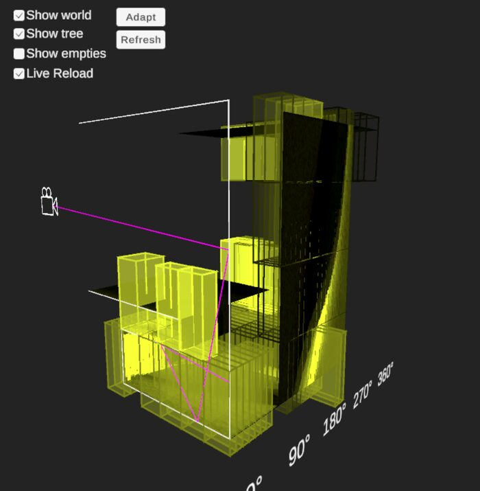

# Visualizing Practical Path Guiding

**Jorge Romeu Huidobro**, [Pavlos Makridis](https://pavlosmak.github.io/)

[Code](https://github.com/PavlosMak/Visualizing-Practical-Path-Guiding)

[Practical Path Guiding](https://tom94.net/data/publications/mueller17practical/mueller17practical.pdf) uses a 5D spatio-directional tree to represent the light field for path guiding, but this data structure is difficult to visualize for a 3D scene. Our key observation is that for the toy task of rendering a 2D scene, the 5D tree becomes 3D, which we can easily visualize. We implement a custom 2D path tracer and an interactive tool where you can trace rays and see how the SD tree learns to represent the light field.
